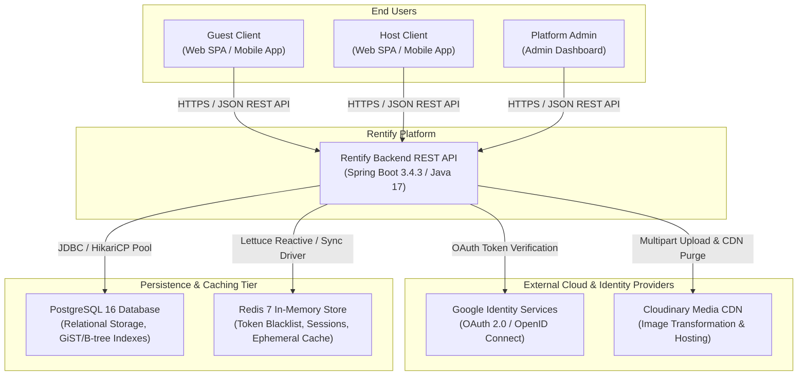
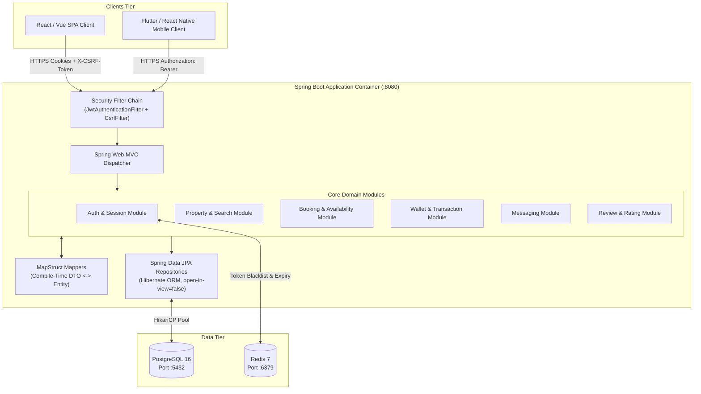
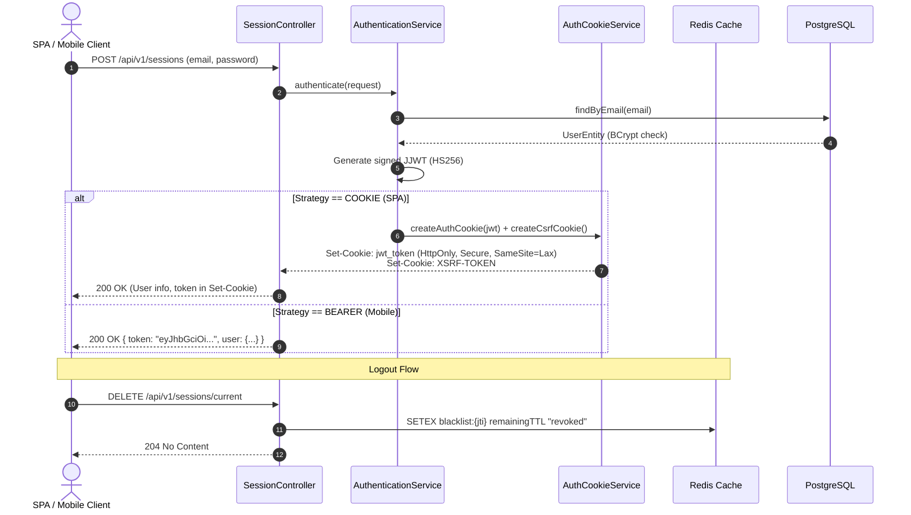
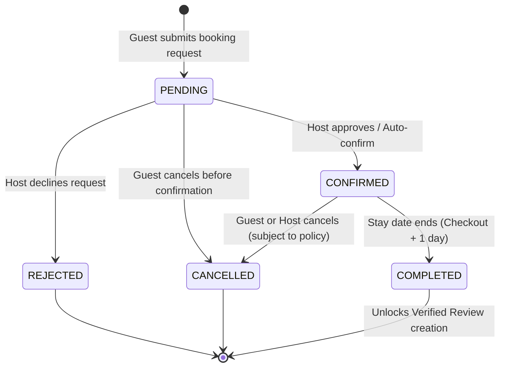
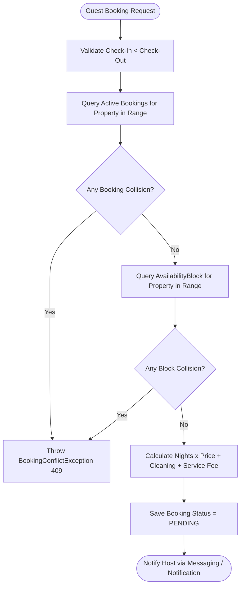
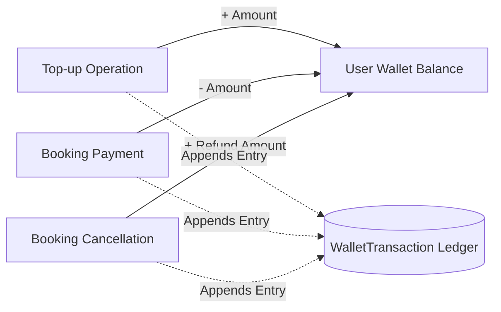

# Rentify Backend — System Architecture & Design Specification

| Field | Value |
|---|---|
| **System** | Rentify Marketplace Backend REST API |
| **Runtime & Platform** | Java 17 LTS / Spring Boot 3.4.3 / Spring Security 6 |
| **Persistence** | PostgreSQL 16 (ACID Relational), Redis 7 (In-Memory Blacklist & Cache) |
| **Architecture Pattern** | Clean Layered Architecture, Domain-Driven Design (DDD) Modularity |
| **Document Classification** | Public Engineering Architecture Specification |

---

## 1. Executive Summary & Core Mission

**Rentify** is a production-grade accommodation booking and real estate rental marketplace backend. It facilitates property discovery, faceted search with geo-clustering, collision-free calendar reservations, host-guest communication, an immutable internal wallet transaction ledger, post-stay verified reviews, and monetization through promotional listing tiers.

The backend is engineered with strict enterprise design rules:
- **Zero-leaks Domain Decoupling**: Database entities are strictly encapsulated within transactional service boundaries. DTOs are mapped at compile-time via MapStruct without runtime reflection overhead.
- **Stateless High-Throughput Auth**: JWT-driven sessions with distributed Redis token blacklisting and dual-mode delivery (HTTP-only SameSite cookies with CSRF validation for SPAs, Bearer tokens for mobile).
- **Zero Double-Booking Guarantee**: Transactional calendar collision engine combining active reservations and host availability blocks with strict date-range collision detection.
- **Anti-N+1 Protection**: `spring.jpa.open-in-view=false` is enforced globally; all association fetching is explicit via JPA 2.1 `@EntityGraph` and JOIN FETCH queries.

---

## 2. High-Level Architecture (C4 Model)

### 2.1 System Context (C4 Level 1)



### 2.2 Container Diagram (C4 Level 2)



---

## 3. Layered Clean Architecture & Data Flow

Rentify Backend adheres to strict unidirectional dependency layering:

```
[ HTTP Request ]
       │
       ▼
┌────────────────────────────────────────────────────────┐
│ Presentation Layer (Controllers & Advisers)            │
│ - Accepts validated DTOs (@Valid, Jakarta Validation)  │
│ - GlobalExceptionHandler (RFC 7807 ProblemDetail)      │
└───────────────────────┬────────────────────────────────┘
                        │ DTOs
                        ▼
┌────────────────────────────────────────────────────────┐
│ Domain & Service Layer (Business Logic & Workflow)     │
│ - State machines & business invariants                 │
│ - Transaction boundaries (@Transactional)              │
│ - MapStruct bidirectional translation                  │
└───────────────────────┬────────────────────────────────┘
                        │ Entities
                        ▼
┌────────────────────────────────────────────────────────┐
│ Data Access Layer (Repositories & Specifications)      │
│ - Spring Data JPA Repositories                         │
│ - JPA Criteria Specifications (Faceted dynamic query)  │
│ - @EntityGraph / JPQL explicit fetches                 │
└───────────────────────┬────────────────────────────────┘
                        │ SQL
                        ▼
┌────────────────────────────────────────────────────────┐
│ Infrastructure & External Adapters                     │
│ - PostgreSQL 16 (HikariCP)                             │
│ - Redis 7 (Lettuce)                                    │
│ - Cloudinary API SDK                                   │
└────────────────────────────────────────────────────────┘
```

---

## 4. Subsystem Architectures

### 4.1 Dual-Mode Authentication & Session Subsystem

Rentify Backend supports dual consumer profiles: single-page applications (vulnerable to XSS if tokens are in LocalStorage) and mobile native applications (which lack cookie handling conventions).



### 4.2 Booking State Machine & Availability Engine

Bookings navigate a deterministic lifecycle enforced at the service level:



#### Collision Prevention Algorithm
When calculating availability or approving a reservation, the calendar engine executes an atomic range check across two tables:
1. `Booking`: Status is not `CANCELLED` and not `REJECTED`.
2. `AvailabilityBlock`: Host manual blackouts or maintenance periods.

$$\text{Collision Condition: } (\text{RequestedStart} < \text{ExistingEnd}) \land (\text{RequestedEnd} > \text{ExistingStart})$$



### 4.3 Internal Wallet & Ledger Immutability

To guarantee zero money leakage and audit compliance:
1. User wallets hold a running balance (`balance`).
2. Every mutation (top-up, booking hold, payout, refund) is backed by an append-only `WalletTransaction` row.
3. Balance mutations use database-level transactional locks (`@Transactional`) to prevent race conditions during simultaneous actions.



---

## 5. Persistence & Query Optimization Strategy

### 5.1 Open-In-View Disabled (`open-in-view=false`)
By default, Spring Boot keeps the Hibernate session open throughout the HTTP request rendering phase, which can mask N+1 query problems and lead to connection pool starvation. 

In Rentify Backend, `spring.jpa.open-in-view` is strictly disabled:
- All database access occurs within `@Transactional` service boundaries.
- Controllers never touch lazy proxies directly.
- All relationships needed for API responses are loaded via `@EntityGraph(attributePaths = {...})` or explicit JPQL `JOIN FETCH` queries.

### 5.2 Dynamic Faceted Filtering
Search queries (`/api/v1/properties`) are compiled dynamically via Spring Data JPA `Specification<Property>`:
- Dynamic predicates: `cityId`, `districtId`, `minPrice`, `maxPrice`, `guestCount`, `bedroomCount`, `amenityIds`, `propertyType`.
- Subqueries for availability date filters: ensures properties with collisions are pruned before pagination limits are applied.
- Paginated results (`Page<PropertyResponseDto>`) ensure minimal memory footprint.

---

## 6. Observability, Security & Production Readiness

- **Exception Management**: Handled via `GlobalExceptionHandler` adhering to RFC 7807 (`ProblemDetail`). Standard HTTP status codes (400, 401, 403, 404, 409, 422, 500) with localized, structured JSON bodies.
- **Audit Logging**: Entities inherit from `CreatedAtEntity` or `AuditableEntity` using Spring Data JPA `@EntityListeners(AuditingEntityListener.class)` to maintain immutable creation and modification timestamps.
- **Container Isolation**: Multi-stage Docker container based on Eclipse Temurin JRE 17 headless distroless pattern to minimize attack surfaces.
