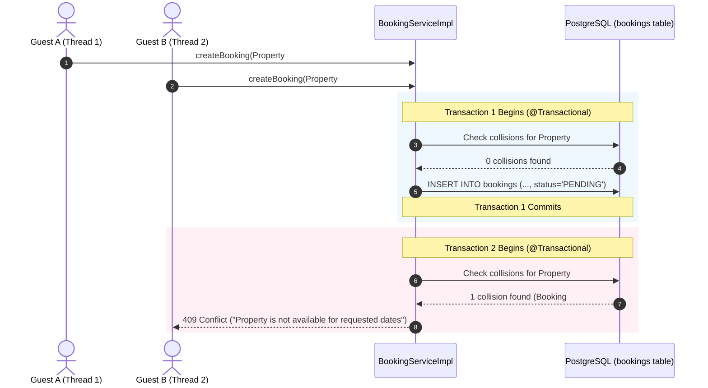
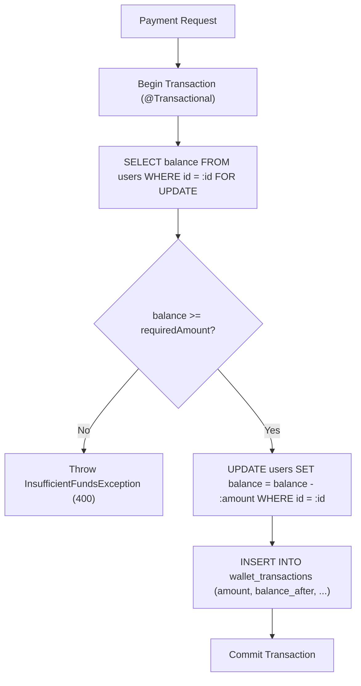

# Concurrency, Transactions & Race Condition Mitigations

| Field | Value |
|---|---|
| **Scope** | Rentify Backend Core Workflows |
| **High-Risk Domains** | Booking Collisions, Wallet Balance Mutation, Promotion Expiry |
| **Transaction Manager** | Spring `JpaTransactionManager` / Hibernate Session |
| **Isolation Defaults** | PostgreSQL `READ COMMITTED` with targeted Lock Escalation |

---

## 1. The Double-Booking Concurrency Challenge

In a multi-tenant accommodation marketplace, two guests may attempt to reserve the same property for overlapping dates simultaneously. Without strict concurrency controls, both requests could pass the availability check in parallel and commit conflicting reservations.

### 1.1 The Collision Condition

For any proposed booking $[\text{start}_{\text{req}}, \text{end}_{\text{req}}]$ and any active reservation or manual host block $[\text{start}_{\text{act}}, \text{end}_{\text{act}}]$, a collision exists if:

$$\text{Collision} \iff (\text{start}_{\text{req}} < \text{end}_{\text{act}}) \land (\text{end}_{\text{req}} > \text{start}_{\text{act}})$$

### 1.2 Mitigation Strategy: Transactional Boundary & Atomic Check



### 1.3 Database-Level Safeguards
To eliminate race conditions when traffic spikes:
1. **Explicit Exclusion Constraints / Pessimistic Locking**:
   For auto-confirming or instant bookings, the query performs an explicit write lock on the target property row:
   ```sql
   SELECT id FROM properties WHERE id = :propertyId FOR UPDATE;
   ```
   This serializes concurrent reservation attempts for that specific property, ensuring deterministic ordering without locking other properties in the system.
2. **Unified Collision Query**:
   ```sql
   SELECT COUNT(b) FROM Booking b 
   WHERE b.property.id = :propertyId 
     AND b.status NOT IN ('CANCELLED', 'REJECTED')
     AND b.startDate < :endDate 
     AND b.endDate > :startDate
   ```
   Combined with checking `AvailabilityBlock` in the same transaction.

---

## 2. Wallet Balance Race Conditions & Double-Spending

### 2.1 The Problem
If a user rapidly fires two simultaneous requests (e.g. paying for a booking and buying a promotion package), reading the current balance and writing back the deducted amount in non-isolated transactions can cause an outdated balance to overwrite the newer one (Lost Update Anomaly).

### 2.2 The Solution: Atomic Ledger & Balance Decrement

Rentify Backend mitigates double-spending using two synchronized layers:



1. **Pessimistic Write Lock (`FOR UPDATE`)**: Prevents any concurrent transaction from reading or mutating the user's wallet until the current transaction commits or rolls back.
2. **Strict Non-Negative Check**: The database column can be bounded with a check constraint:
   ```sql
   ALTER TABLE users ADD CONSTRAINT check_wallet_balance_positive CHECK (wallet_balance >= 0.00);
   ```

---

## 3. Scheduled Tasks & Cron Job Concurrency

The backend features background schedulers (e.g., checking for expired promotions, auto-completing bookings past checkout).

### Guarding Against Overlapping Scheduler Runs
1. **Fixed Delay vs Fixed Rate**: Schedulers use `@Scheduled(fixedDelayString = "...")` to guarantee that the next execution will only start after the previous iteration has completed, preventing thread pile-ups.
2. **Chunked Processing**: Schedulers process records in batches with discrete transactions rather than one massive long-running transaction:
   ```java
   @Scheduled(fixedDelay = 60000)
   public void expirePromotions() {
       List<Long> expiredIds = propertyRepository.findExpiredPromotionIds(Instant.now());
       for (Long id : expiredIds) {
           propertyService.deactivatePromotionInNewTransaction(id);
       }
   }
   ```

---

## 4. Cache & Token Invalidation Concurrency (Redis)

Token revocations during user logout or password changes execute against Redis:
- **Atomic Blacklisting**: Tokens are added using Redis atomic primitives:
  ```text
  SET blacklist:<jti> "revoked" EX <remaining_seconds>
  ```
- No distributed locking overhead is required for blacklist verification because Redis single-threaded execution guarantees that `EXISTS blacklist:<jti>` is always atomic and instantaneous.
