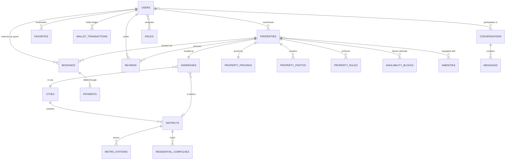

# Rentify Backend — Database Schema & Data Architecture

| Field | Value |
|---|---|
| **DBMS** | PostgreSQL 16 (Relational ACID) |
| **ORM Framework** | Hibernate 6.x / Spring Data JPA |
| **Connection Pooling** | HikariCP (`maximum-pool-size: 10`, `minimum-idle: 5`) |
| **Session Policy** | `spring.jpa.open-in-view: false` (Zero lazy-loading leaks) |
| **Auditing** | Spring Data JPA Auditing (`AuditableEntity`, `CreatedAtEntity`) |

---

## 1. Entity-Relationship Overview



---

## 2. Table Specifications & Data Dictionary

### 2.1 Identity & Access Management

#### `users`
Core user record for both guests, hosts, and platform administrators.
| Column | Type | Constraints | Description |
|---|---|---|---|
| `id` | `BIGSERIAL` | `PRIMARY KEY` | Unique synthetic identifier |
| `email` | `VARCHAR(255)` | `NOT NULL, UNIQUE` | Normalized login email address |
| `password` | `VARCHAR(255)` | `NULLABLE` | BCrypt password hash (null for pure OAuth users) |
| `first_name` | `VARCHAR(100)` | `NOT NULL` | User given name |
| `last_name` | `VARCHAR(100)` | `NOT NULL` | User family name |
| `phone_number` | `VARCHAR(30)` | `NULLABLE` | Contact phone for booking confirmations |
| `avatar_url` | `VARCHAR(500)` | `NULLABLE` | Cloudinary CDN public URL |
| `wallet_balance`| `NUMERIC(12, 2)`| `NOT NULL DEFAULT 0.00` | In-app credit balance (UAH) |
| `status` | `VARCHAR(30)` | `NOT NULL DEFAULT 'ACTIVE'`| Account lifecycle state (`ACTIVE`, `SUSPENDED`, `DELETED`) |
| `created_at` | `TIMESTAMPTZ` | `NOT NULL` | Registration timestamp |
| `updated_at` | `TIMESTAMPTZ` | `NOT NULL` | Profile modification timestamp |

#### `roles` & `user_roles`
RBAC association mapping users to system privileges.
* Roles: `ROLE_GUEST`, `ROLE_HOST`, `ROLE_ADMIN`.

---

### 2.2 Property & Location Domain

#### `properties`
Accommodations and rental listings published by hosts.
| Column | Type | Constraints | Description |
|---|---|---|---|
| `id` | `BIGSERIAL` | `PRIMARY KEY` | Unique property identifier |
| `host_id` | `BIGINT` | `NOT NULL, FK(users.id)` | Owner host reference |
| `title` | `VARCHAR(255)` | `NOT NULL` | Listing headline |
| `description` | `TEXT` | `NOT NULL` | Detailed property overview and features |
| `property_type` | `VARCHAR(50)` | `NOT NULL` | `APARTMENT`, `HOUSE`, `STUDIO`, `ROOM` |
| `max_guests` | `INTEGER` | `NOT NULL` | Maximum guest capacity |
| `bedroom_count` | `INTEGER` | `NOT NULL` | Number of bedrooms |
| `bathroom_count`| `INTEGER` | `NOT NULL` | Number of bathrooms |
| `status` | `VARCHAR(30)` | `NOT NULL DEFAULT 'DRAFT'` | `DRAFT`, `ACTIVE`, `INACTIVE`, `BLOCKED` |
| `average_rating`| `NUMERIC(3, 2)`| `NOT NULL DEFAULT 0.00` | Cached aggregate review score |
| `review_count` | `INTEGER` | `NOT NULL DEFAULT 0` | Total verified reviews count |
| `is_promoted` | `BOOLEAN` | `NOT NULL DEFAULT FALSE` | VIP/Top placement flag |
| `created_at` | `TIMESTAMPTZ` | `NOT NULL` | Listing creation time |
| `updated_at` | `TIMESTAMPTZ` | `NOT NULL` | Listing update time |

#### `property_pricings`
Monetary rates associated with each property.
| Column | Type | Constraints | Description |
|---|---|---|---|
| `property_id` | `BIGINT` | `PRIMARY KEY, FK(properties.id)` | One-to-one property relation |
| `price_per_night` | `NUMERIC(10, 2)` | `NOT NULL` | Standard nightly rental fee |
| `cleaning_fee` | `NUMERIC(10, 2)` | `NOT NULL DEFAULT 0.00` | One-off cleaning surcharge per booking |
| `service_fee` | `NUMERIC(10, 2)` | `NOT NULL DEFAULT 0.00` | Platform servicing surcharge |
| `currency` | `VARCHAR(3)` | `NOT NULL DEFAULT 'UAH'` | ISO currency code |

#### `addresses`
Spatial and physical geolocation coordinates.
| Column | Type | Constraints | Description |
|---|---|---|---|
| `property_id` | `BIGINT` | `PRIMARY KEY, FK(properties.id)` | One-to-one property relation |
| `city_id` | `BIGINT` | `NOT NULL, FK(cities.id)` | City taxonomy reference |
| `district_id` | `BIGINT` | `NULLABLE, FK(districts.id)` | District / municipal area reference |
| `street` | `VARCHAR(255)` | `NOT NULL` | Street name and building number |
| `apartment` | `VARCHAR(50)` | `NULLABLE` | Apartment or suite number |
| `latitude` | `DOUBLE PRECISION`| `NOT NULL` | Geographic latitude |
| `longitude`| `DOUBLE PRECISION`| `NOT NULL` | Geographic longitude |

---

### 2.3 Calendar, Booking & Conflict Engine

#### `bookings`
Guest reservation agreements and date ranges.
| Column | Type | Constraints | Description |
|---|---|---|---|
| `id` | `BIGSERIAL` | `PRIMARY KEY` | Unique booking identifier |
| `property_id` | `BIGINT` | `NOT NULL, FK(properties.id)` | Target property |
| `guest_id` | `BIGINT` | `NOT NULL, FK(users.id)` | Booking guest |
| `start_date` | `DATE` | `NOT NULL` | Check-in calendar date |
| `end_date` | `DATE` | `NOT NULL` | Check-out calendar date |
| `total_price` | `NUMERIC(12, 2)` | `NOT NULL` | Full calculated cost |
| `guest_count` | `INTEGER` | `NOT NULL` | Number of attending guests |
| `status` | `VARCHAR(30)` | `NOT NULL DEFAULT 'PENDING'` | `PENDING`, `CONFIRMED`, `REJECTED`, `CANCELLED`, `COMPLETED` |
| `cancellation_reason` | `VARCHAR(500)` | `NULLABLE` | Explanation if cancelled/rejected |
| `created_at` | `TIMESTAMPTZ` | `NOT NULL` | Timestamp of booking creation |

#### `availability_blocks`
Host manual calendar blockouts (renovations, personal use, offline reservations).
| Column | Type | Constraints | Description |
|---|---|---|---|
| `id` | `BIGSERIAL` | `PRIMARY KEY` | Unique block identifier |
| `property_id` | `BIGINT` | `NOT NULL, FK(properties.id)` | Target property |
| `start_date` | `DATE` | `NOT NULL` | Block start date |
| `end_date` | `DATE` | `NOT NULL` | Block end date |
| `reason` | `VARCHAR(255)` | `NULLABLE` | Internal reason note |

---

### 2.4 Financial Ledger & Audit Trail

#### `wallet_transactions`
Append-only immutable record of financial movements.
| Column | Type | Constraints | Description |
|---|---|---|---|
| `id` | `BIGSERIAL` | `PRIMARY KEY` | Transaction identifier |
| `user_id` | `BIGINT` | `NOT NULL, FK(users.id)` | Account holder |
| `amount` | `NUMERIC(12, 2)` | `NOT NULL` | Amount (+ for credits, - for debits) |
| `balance_after` | `NUMERIC(12, 2)` | `NOT NULL` | Running balance checkpoint |
| `transaction_type` | `VARCHAR(50)` | `NOT NULL` | `TOP_UP`, `BOOKING_PAYMENT`, `BOOKING_REFUND`, `HOST_PAYOUT`, `PROMOTION_PAYMENT` |
| `reference_id` | `BIGINT` | `NULLABLE` | Related Entity ID (e.g., `booking_id`) |
| `created_at` | `TIMESTAMPTZ` | `NOT NULL` | Immutable audit timestamp |

---

## 3. Indexing Strategy & Query Optimization

```sql
-- 1. Fast User Lookups
CREATE UNIQUE INDEX idx_users_email ON users(email);

-- 2. Faceted Search Optimization on Properties
CREATE INDEX idx_properties_search ON properties(status, city_id, property_type, max_guests);
CREATE INDEX idx_properties_rating ON properties(average_rating DESC);
CREATE INDEX idx_properties_promoted ON properties(is_promoted DESC) WHERE status = 'ACTIVE';

-- 3. Geo-Coordinates for Map Pin Fetching
CREATE INDEX idx_addresses_coords ON addresses(latitude, longitude);

-- 4. Fast Collision Lookup for Availability
CREATE INDEX idx_bookings_collision ON bookings(property_id, start_date, end_date) 
WHERE status NOT IN ('CANCELLED', 'REJECTED');

CREATE INDEX idx_availability_collision ON availability_blocks(property_id, start_date, end_date);

-- 5. Wallet Ledger History (Paginated)
CREATE INDEX idx_wallet_tx_user_created ON wallet_transactions(user_id, created_at DESC);
```

---

## 4. Entity Relationship Integrity & Delete Policies

1. **Host Deactivation**: Deleting a user does NOT drop properties or financial transaction logs; instead, status flags (`SUSPENDED` / `DELETED`) are used to preserve historical integrity.
2. **Property Removal**: Cascading soft-delete flags or inactive statuses (`INACTIVE`) prevent orphan booking references or corrupting historical reviews.
3. **Transaction Immutability**: No `UPDATE` or `DELETE` queries are ever permitted on `wallet_transactions`. All corrections occur through compensatory transactions (`REFUND` / `ADJUSTMENT`).
