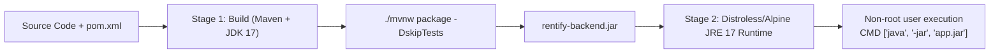

# Deployment, Operations & DevOps Guide

| Field | Value |
|---|---|
| **Packaging** | Multi-Stage Docker Container (Eclipse Temurin JRE 17) |
| **Local Orchestration** | Docker Compose (API, PostgreSQL 16, Redis 7) |
| **Base Image** | `eclipse-temurin:17-jre-alpine` (Minimal attack surface) |
| **Observability** | Spring Boot Actuator (`/actuator/health`, `/actuator/metrics`) |

---

## 1. Multi-Stage Docker Build Architecture

The `Dockerfile` employs multi-stage caching to compile the application and produce an ultra-lean runtime image:



---

## 2. Environment Configuration Matrix

Rentify uses `.env` configuration (mapped to `application.yml` via environment variables).

| Variable | Description | Required | Default / Example |
|---|---|:---:|---|
| `SERVER_PORT` | HTTP listening port | No | `8080` |
| `SPRING_DATASOURCE_URL` | PostgreSQL JDBC connection URL | Yes | `jdbc:postgresql://localhost:5432/rentify_db` |
| `SPRING_DATASOURCE_USERNAME` | Database username | Yes | `postgres` |
| `SPRING_DATASOURCE_PASSWORD` | Database user password | Yes | `secret` |
| `SPRING_DATA_REDIS_HOST` | Redis host | Yes | `localhost` |
| `SPRING_DATA_REDIS_PORT` | Redis port | No | `6379` |
| `JWT_SECRET` | Secret key for HMAC-SHA256 tokens | Yes | 64+ char random hex string |
| `JWT_EXPIRATION_MS` | Access token time-to-live in ms | No | `86400000` (24h) |
| `AUTH_STRATEGY` | Authentication strategy (`cookie` / `bearer`) | No | `cookie` |
| `GOOGLE_CLIENT_ID` | Google OAuth Client ID for SSO | No | `your-google-client-id.apps.googleusercontent.com` |
| `CLOUDINARY_CLOUD_NAME` | Cloudinary cloud account identifier | Yes | `rentify-cloud` |
| `CLOUDINARY_API_KEY` | Cloudinary API access key | Yes | `1234567890` |
| `CLOUDINARY_API_SECRET` | Cloudinary API secret | Yes | `abcdef123456` |

---

## 3. Local Deployment via Docker Compose

To spin up the entire ecosystem (PostgreSQL, Redis, Backend API) with a single command:

```bash
# 1. Clone repository and navigate to root
cd rentify-backend

# 2. Copy environment template
cp .env.example .env

# 3. Launch all services
docker compose up -d --build

# 4. Tail application logs
docker compose logs -f backend
```

---

## 4. Production Checklist & Observability

- [ ] **Database Connection Pool**: Tune `maximum-pool-size` based on container CPU count.
- [ ] **Security Keys**: Generate a cryptographically secure 512-bit string for `JWT_SECRET`.
- [ ] **CORS Settings**: Restrict `allowed-origins` strictly to your production frontend domain.
- [ ] **Actuator Endpoints**: Restrict sensitive endpoints (`/actuator/env`, `/actuator/beans`); keep `/actuator/health` open for container orchestration health checks.
- [ ] **Log Level**: Set `logging.level.root=WARN` and `logging.level.com.rentify=INFO` in production to reduce I/O pressure.
