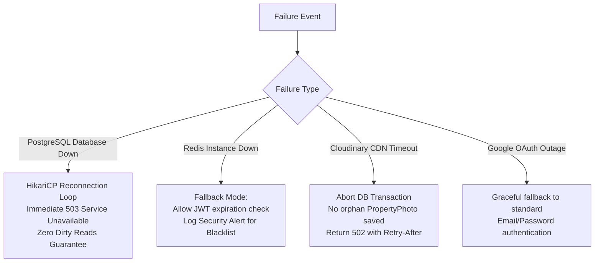

# Failures, Resilience & Disaster Recovery

| Field | Value |
|---|---|
| **Scope** | Failure Modes, Circuit Breaking, Fallbacks & Error Semantics |
| **Error Format** | RFC 7807 (`ProblemDetail`) / Application JSON |
| **Resilience Model** | Fail-safe defaults, isolated transaction boundaries, compensatory rollbacks |

---

## 1. Unified Error Handling Architecture (RFC 7807)

Rentify Backend adheres to **RFC 7807 (Problem Details for HTTP APIs)**. The application maps all internal exceptions through a centralized `@RestControllerAdvice` (`GlobalExceptionHandler`), preventing stack trace leaks and presenting deterministic error schemas to API consumers.

### Standard Error Response Schema
```json
{
  "type": "https://api.rentify.com/errors/booking-conflict",
  "title": "Booking Date Conflict",
  "status": 409,
  "detail": "Property #42 is already booked for the specified dates [2026-11-01 to 2026-11-05]",
  "instance": "/api/v1/bookings",
  "timestamp": "2026-10-26T18:25:00Z",
  "errors": []
}
```

### Exception to HTTP Status Mapping Matrix

| Internal Exception | HTTP Status | Mitigation / Client Action |
|---|:---:|---|
| `MethodArgumentNotValidException` | `400 Bad Request` | Client fixes DTO validation errors returned in `errors` list. |
| `BadCredentialsException` | `401 Unauthorized` | Client provides valid email/password. |
| `TokenExpiredException` / `JwtException` | `401 Unauthorized` | Client refreshes credentials or re-authenticates. |
| `AccessDeniedException` | `403 Forbidden` | User lacks required role or ownership. |
| `ResourceNotFoundException` | `404 Not Found` | Requested entity ID does not exist. |
| `BookingConflictException` | `409 Conflict` | Dates unavailable; client reloads calendar matrix. |
| `InsufficientFundsException` | `422 Unprocessable Entity` | Wallet balance too low; client must trigger top-up. |
| `ExternalServiceException` | `502 Bad Gateway` | Upstream provider (Cloudinary/Google) failure; client retries with exponential backoff. |

---

## 2. Infrastructure Failure Modes & Recovery Strategies



### 2.1 PostgreSQL Database Unavailability
- **HikariCP Pool Configuration**:
  * `connectionTimeout: 30000ms` (Prevents threads hanging indefinitely waiting for connections).
  * `maxLifetime: 1800000ms` (Retires stale connections periodically).
  * `leakDetectionThreshold: 20000ms` (Detects and logs unclosed connections in developer/staging logs).
- **Transactional Rollback Guarantees**:
  All domain mutations declare `@Transactional(rollbackFor = Exception.class)`. Any database communication drop triggers an immediate rollback of the current boundary, preventing partial writes.

### 2.2 Redis Cache / Blacklist Outage
- **Token Blacklisting Policy**:
  * If Redis goes offline, the `JwtAuthenticationFilter` can be configured either in **Strict Fail-Closed** mode (rejecting requests until Redis recovers) or **Graceful Fail-Open** mode (validating JWT cryptographic signatures and exp times while logging warnings about temporary blacklist unreachability).
  * By setting short-lived JWT lifetimes (e.g. 15–60 minutes), the attack window during a Redis downtime is minimized.

### 2.3 Cloudinary Media Upload Failures
- **Compensatory Rollbacks**:
  When a host uploads multiple listing images:
  1. Images are uploaded to Cloudinary SDK.
  2. Database records are persisted in a single transaction.
  3. If database persistence fails after upload, the service triggers an asynchronous compensatory cleanup (`cloudinary.uploader().destroy(...)`) using the uploaded public IDs, avoiding cloud storage billing leaks.

---

## 3. Data Integrity & Disaster Recovery (DR)

1. **Database Backups (WAL Archival & Daily Dumps)**:
   - Automated `pg_dump` scheduled daily to secure offsite object storage.
   - Continuous Write-Ahead Log (WAL) archiving enables Point-In-Time Recovery (PITR) to any second within a 14-day retention window.
2. **Health Check Probes (Spring Boot Actuator)**:
   - Endpoint: `/actuator/health`
   - Readiness Probe: Validates PostgreSQL and Redis socket reachability before routing traffic.
   - Liveness Probe: Verifies JVM responsiveness.
