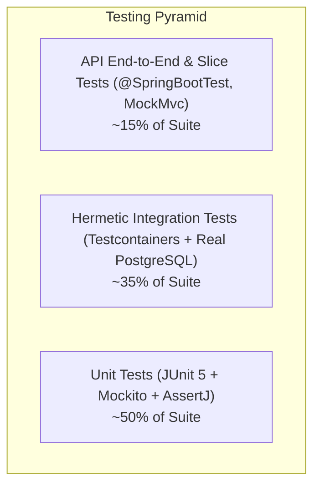

# Testing Strategy & Quality Assurance

| Field | Value |
|---|---|
| **Test Engine** | JUnit 5 (Jupiter), Mockito, AssertJ |
| **Integration Framework** | Testcontainers 1.21+ (Hermetic PostgreSQL 16 Container) |
| **Test Suite Volume** | 200+ Automated Unit & Integration Tests |
| **Execution Tooling** | Maven Surefire & Failsafe (`./mvnw test`, `./mvnw verify`) |

---

## 1. Test Pyramid & Methodology

Rentify Backend utilizes a testing pyramid designed for fast feedback loops and exact production parity:



### 1.1 Unit Tests (Service & Domain Layer)
- **Target**: Pure business logic, validation rules, state transitions, and price calculations.
- **Dependencies**: Repositories and external services are mocked using `@Mock` / `Mockito`.
- **Characteristics**: Extremely fast (<10ms per test), zero network calls, zero database overhead.

### 1.2 Hermetic Integration Tests (Testcontainers)
Instead of using in-memory databases like H2 (which do not support PostgreSQL-specific dialect features, JSONB, or identical constraint locking), Rentify runs all integration tests against an automated, ephemeral **PostgreSQL 16 Testcontainer**.

```java
@Testcontainers
@SpringBootTest
@AutoConfigureMockMvc
abstract class BaseIntegrationTest {

    @Container
    static PostgreSQLContainer<?> postgres = new PostgreSQLContainer<>("postgres:16-alpine")
            .withDatabaseName("rentify_test")
            .withUsername("test")
            .withPassword("test");

    @DynamicPropertySource
    static void configureProperties(DynamicPropertyRegistry registry) {
        registry.add("spring.datasource.url", postgres::getJdbcUrl);
        registry.add("spring.datasource.username", postgres::getUsername);
        registry.add("spring.datasource.password", postgres::getPassword);
    }
}
```

---

## 2. Testing Specific Subsystems

### 2.1 Testing Calendar & Booking Collision Engine
- Tests cover every edge case of date intervals:
  - Exact match overlap $[t_1, t_2] \cap [t_1, t_2]$
  - Partial start overlap $[t_0, t_1] \cap [t_1, t_2]$ (Boundary test: check-out day allowed as next check-in)
  - Enclosed interval overlap
  - Manual host block collisions vs active booking collisions
  - Multi-threaded race condition tests verifying transaction isolation.

### 2.2 Testing Authentication & Security Filters
- Verification of token expiration and signature tampering.
- Verification of Redis blacklist lookup: ensuring logged-out tokens are immediately rejected.
- Dual-mode verification: testing cookie extraction and CSRF headers vs Bearer header authentication.

### 2.3 Testing MapStruct DTO Mappings
- Verifying bidirectional translation without entity field leaks.
- Ensuring null safety and default fallback values.

---

## 3. Running the Test Suite Locally

```bash
# Run unit tests only (fast)
./mvnw test

# Run full integration test suite with Testcontainers (requires Docker)
./mvnw verify

# Run a specific test class
./mvnw test -Dtest=BookingServiceTest
```
