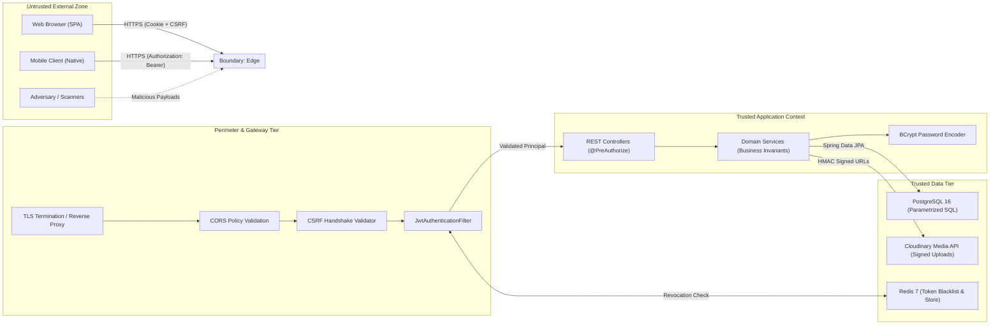

# Threat Model & Security Architecture

| Field | Value |
|---|---|
| **Target System** | Rentify Backend Marketplace REST API |
| **Document Version** | 1.0.0 |
| **Standard Framework** | STRIDE / Microsoft Threat Modeling Standard |
| **Classification** | Public Security Architecture Document |

---

## 1. Trust Boundaries & Perimeter Overview

Rentify Backend handles sensitive financial ledgers, identity tokens, private guest-host chat communications, and booking contracts.



### Trust Boundary Definitions
1. **Perimeter Boundary**: Separates external clients from the internal Spring application. All inputs are untrusted and must pass JSON parsing, Bean Validation (`@Valid`), and CORS/CSRF filters.
2. **Identity & Principal Boundary**: Once JWT is parsed and verified against Redis blacklists, the security context is populated with an authenticated `UserPrincipal` and verified roles.
3. **Data Access Boundary**: JPA Repositories isolate application code from direct SQL, preventing SQL injection by design.

---

## 2. STRIDE Threat Analysis Matrix

| Threat Category | Potential Attack Vector | Rentify Architectural Countermeasure | Risk Level |
|---|---|---|:---:|
| **Spoofing** | Forging JWT signature or reusing revoked tokens | HMAC-SHA256 signature verification with secret key; instant token revocation via Redis Blacklist on logout/password change. Google OAuth token signature verified using Google's public JWK keys. | **High (Mitigated)** |
| **Tampering** | Modifying booking dates, prices or wallet balance in transit | Request body is strictly validated via Jakarta Validation. Prices are calculated server-side exclusively by `PropertyPricingService`; client price overrides are ignored. | **Critical (Mitigated)** |
| **Repudiation** | User denies performing a wallet payment or booking cancellation | All mutations write to immutable append-only `WalletTransaction` and audit-logged entities with timestamps (`createdAt`, `updatedAt`). | **Medium (Mitigated)** |
| **Information Disclosure** | Exposing user password hashes or sensitive booking records to other guests | Passwords stored strictly as BCrypt hashes; MapStruct mappers exclude internal fields; IDOR checks enforce that users can only access their own bookings/messages (`@PreAuthorize` + service ownership checks). | **High (Mitigated)** |
| **Denial of Service** | Uploading massive multi-gigabyte media or flooding search with unbounded queries | Multi-part uploads limited to max 10MB per image; Cloudinary handles offloading image resizing; database queries enforce mandatory pagination (`Pageable` with bounded page size). | **Medium (Mitigated)** |
| **Elevation of Privilege** | Normal guest attempting host operations or admin privileges | Spring Security Role-Based Access Control (`ROLE_GUEST`, `ROLE_HOST`, `ROLE_ADMIN`) verified before controller execution. Listing editing restricted to verified owner host ID. | **Critical (Mitigated)** |

---

## 3. Detailed Security Mechanisms

### 3.1 Dual-Mode Authentication & CSRF Protection
1. **SPA Mode (`AUTH_STRATEGY=cookie`)**:
   - `jwt_token` is written to an `HttpOnly`, `Secure`, `SameSite=Lax` cookie. JavaScript running in the browser cannot read this cookie, eliminating XSS token theft.
   - To prevent Cross-Site Request Forgery (CSRF), mutations (`POST`, `PUT`, `DELETE`, `PATCH`) must send the `X-CSRF-Token` header matching the readable CSRF cookie issued during login.
2. **Mobile Mode (`AUTH_STRATEGY=bearer`)**:
   - Native apps supply tokens in standard `Authorization: Bearer <token>` headers. CSRF checks are bypassed because mobile clients are not subject to browser ambient cookie credentials.

### 3.2 Insecure Direct Object Reference (IDOR) Defenses
Every endpoint accessing personal or proprietary resources enforces identity parity:

```java
// Example: Ownership verification inside BookingServiceImpl
Booking booking = bookingRepository.findById(bookingId)
    .orElseThrow(() -> new ResourceNotFoundException("Booking", bookingId));

Long currentUserId = SecurityUtils.getCurrentUserId();
boolean isGuest = booking.getGuest().getId().equals(currentUserId);
boolean isHost = booking.getProperty().getHost().getId().equals(currentUserId);
boolean isAdmin = SecurityUtils.hasRole("ROLE_ADMIN");

if (!isGuest && !isHost && !isAdmin) {
    throw new AccessDeniedException("You do not have permission to view or modify this booking");
}
```

### 3.3 Media Upload Integrity (Cloudinary)
- File types are strictly validated on the backend (allowing only `image/jpeg`, `image/png`, `image/webp`).
- Executable files or scripts masked as images are rejected before transmission to Cloudinary.
- Photos are assigned random UUID names on Cloudinary, preventing path traversal attacks.
